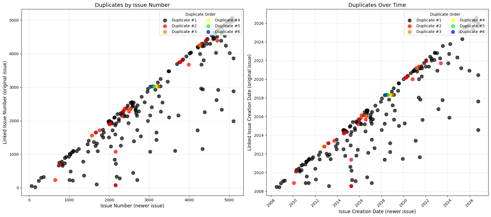

# Apache Jira issue analysis

Notebooks from my data science internship, using public issue data from Apache's Jira (https://issues.apache.org/jira).

There are two parts:

1. **Issue type classification (Kafka).** Given the title and description of a Kafka issue, predict its type (Bug, Improvement, New Feature, Sub-task, Task, Test or Wish). I tried three models of increasing size: a neural net on TF-IDF features, a BiLSTM with GloVe embeddings, and a fine-tuned BERT.
2. **Issue links and duplicates (ZooKeeper).** Pull every link between ZooKeeper issues, plot the link network, look at which issues get marked as duplicates of earlier ones, and then try to find the original issue for a duplicate automatically from the text.

## Data

Everything is pulled live with the `jira` Python library, no login needed. Kafka has about 19.5k issues. Because it is live, the counts are slightly different every time a notebook is run (19,446 to 19,516 Kafka issues across my runs).

The Kafka classes are very uneven. Bug is nearly half the data and Wish is under 1%:

| Bug | Improvement | Sub-task | Task | Test | New Feature | Wish |
|---|---|---|---|---|---|---|
| 8905 | 5021 | 3325 | 872 | 651 | 607 | 135 |

## Results: issue type classification

80/20 stratified split, summary + description as the input text.

| Model | Accuracy | Macro F1 |
|---|---|---|
| TF-IDF + neural net | 0.599 | 0.363 |
| BiLSTM (GloVe) | 0.600 | 0.381 |
| BERT (bert-base-uncased) | 0.687 | 0.429 |
| BERT, best of lr/epoch grid (3e-5, 4 epochs) | 0.679 | 0.452 |

BERT is clearly better than the other two, mostly on Bug and Improvement. All three struggle with the small classes. Wish is almost never predicted and Task gets mixed up with Improvement, which is why macro F1 is so much lower than accuracy.

The grid search was scored on the test set, so the tuned number is a bit optimistic. A proper version would hold out a validation set for picking the settings.

Full classification reports and the confusion matrix are in [RESULTS.md](RESULTS.md).

## Results: ZooKeeper links

4935 issues and 1159 links between them after removing the mirrored copies. About 190 of those are duplicate links. Most duplicates are raised soon after the original, but some point back to issues from years earlier.

## Results: duplicate detection

For each of the 179 ZooKeeper issues marked as a duplicate, rank all earlier issues by text similarity and see where the real original comes.

| Method | Recall@1 | Recall@5 | Recall@10 | Median rank |
|---|---|---|---|---|
| Random | 0.000 | 0.000 | 0.000 | 1186 |
| TF-IDF | 0.374 | 0.581 | 0.687 | 3 |
| MiniLM embeddings | 0.358 | 0.564 | 0.665 | 4 |

So the original is in the top 10 about two thirds of the time, out of roughly 2,800 earlier issues on average. TF-IDF and MiniLM are basically level. The misses are mostly duplicates that describe the same underlying problem in completely different words, like a segfault report whose original is about an xid overflow.

## Notebooks

| Notebook | What it does |
|---|---|
| `01_zookeeper_links_and_duplicates.ipynb` | Collects ZooKeeper issue links, draws the network, plots duplicates over time |
| `02_kafka_exploration_and_bilstm.ipynb` | Kafka class counts and the BiLSTM model |
| `03_kafka_tfidf_nn.ipynb` | TF-IDF + feed-forward neural net |
| `04_kafka_bert.ipynb` | Fine-tuned BERT |
| `05_kafka_bert_tuning.ipynb` | BERT over 3 learning rates x 2 epoch settings |
| `06_zookeeper_duplicate_detection.ipynb` | Ranks earlier issues by text similarity to find the original of a duplicate (TF-IDF vs MiniLM embeddings) |

## Running them

The easiest way is Google Colab, since the notebooks were written there.

1. Go to https://colab.research.google.com, then File > Open notebook > GitHub.
2. Paste `stephenjglass/apache-jira-issue-analysis` and pick a notebook.
3. For 02, 04, 05 and 06 switch on the GPU first: Runtime > Change runtime type > T4 GPU.
4. Runtime > Run all.

Each notebook installs what it needs in its first cell and downloads its own data, so there is nothing to set up. Downloading all the Kafka issues takes a few minutes. The BERT notebooks are the slow ones, and the tuning notebook trains BERT six times.

To run locally instead: `pip install -r requirements.txt` and open the notebooks in Jupyter. A GPU is needed for the BERT ones to finish in reasonable time.
