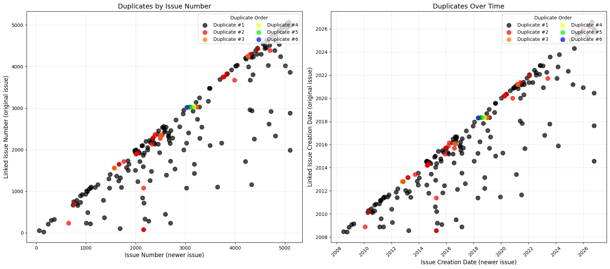

# Results

Outputs copied from the saved notebook runs. Each notebook pulls the data live, so the issue counts are slightly different each time.

## Class counts (from notebook 05, 19516 issues)

```
type
Bug            8905
Improvement    5021
Sub-task       3325
Task            872
Test            651
New Feature     607
Wish            135
Name: count, dtype: int64
```

## 03 TF-IDF + neural net (19454 issues)

```
Accuracy: 0.5988
Macro F1: 0.3629
Weighted F1: 0.5840

Classification Report:
              precision    recall  f1-score   support

         Bug       0.71      0.79      0.75      1775
 Improvement       0.48      0.43      0.46      1001
 New Feature       0.25      0.17      0.20       121
    Sub-task       0.54      0.61      0.57       663
        Task       0.34      0.16      0.21       174
        Test       0.39      0.31      0.34       130
        Wish       0.00      0.00      0.00        27

    accuracy                           0.60      3891
   macro avg       0.39      0.35      0.36      3891
weighted avg       0.58      0.60      0.58      3891
```

## 02 BiLSTM with GloVe (19446 issues)

```
Accuracy: 0.5995
Macro F1: 0.3812
Weighted F1: 0.5977

Classification Report:
              precision    recall  f1-score   support

         Bug       0.77      0.72      0.74      1775
 Improvement       0.46      0.59      0.52      1001
 New Feature       0.27      0.18      0.22       121
    Sub-task       0.61      0.56      0.58       663
        Task       0.21      0.13      0.16       174
        Test       0.38      0.40      0.39       130
        Wish       0.17      0.04      0.06        26

    accuracy                           0.60      3890
   macro avg       0.41      0.37      0.38      3890
weighted avg       0.60      0.60      0.60      3890
```

## 04 BERT, lr 2e-5, 3 epochs (19491 issues)

```
Accuracy: 0.6866
Macro F1: 0.4291
Weighted F1: 0.6757

Classification Report:
              precision    recall  f1-score   support

         Bug       0.83      0.82      0.82      1779
 Improvement       0.56      0.68      0.61      1003
 New Feature       0.39      0.24      0.30       121
    Sub-task       0.63      0.66      0.65       665
        Task       0.40      0.13      0.20       174
        Test       0.56      0.35      0.43       130
        Wish       0.00      0.00      0.00        27

    accuracy                           0.69      3899
   macro avg       0.48      0.41      0.43      3899
weighted avg       0.68      0.69      0.68      3899

Confusion Matrix:
[[1457  229    1   69    5   18    0]
 [ 152  683   33  116   13    6    0]
 [   4   71   29   17    0    0    0]
 [  65  130    7  440   13   10    0]
 [  35   75    2   37   23    2    0]
 [  41   22    1   17    4   45    0]
 [   5   20    1    1    0    0    0]]
```

## 05 BERT tuning

```
 learning_rate  epochs  batch_size  max_len  accuracy  macro_f1  weighted_f1
       0.00001       3          16      128  0.681096  0.383522     0.659607
       0.00001       4          16      128  0.687244  0.418136     0.672533
       0.00002       3          16      128  0.682377  0.418168     0.668923
       0.00002       4          16      128  0.686988  0.443953     0.678040
       0.00003       3          16      128  0.688525  0.439253     0.679054
       0.00003       4          16      128  0.679047  0.451451     0.673508

Best model:
Learning rate: 3e-05
Epochs: 4
Macro F1: 0.4515
Accuracy: 0.6790
```

## 01 ZooKeeper links and duplicates

4935 ZooKeeper issues, 2531 links between them. Each link shows up on both issues, so only the copy on the newer issue is kept, and links to other projects are dropped.

```
Links kept: 1159
Unique issues: 903
Unique linked issues: 773

Link types (top 8):
relates to: 293
is related to: 257
duplicates: 129
is duplicated by: 63
depends upon: 58
supercedes: 51
is a clone of: 33
incorporates: 29
```



Most duplicates sit close to the diagonal, so they were raised not long after the original. The points well below it are issues that duplicate something filed years earlier.

## 06 Duplicate detection

192 duplicate pairs, 179 issues that duplicate an earlier one. For each of those, every earlier issue is ranked by text similarity (about 2,800 candidates on average) and the rank of the real original is recorded.

```
method  recall@1  recall@5  recall@10   MRR  median rank
Random     0.000     0.000      0.000 0.002       1186.0
TF-IDF     0.374     0.581      0.687 0.473          3.0
MiniLM     0.358     0.564      0.665 0.451          4.0
```

TF-IDF and MiniLM are close. The gap is about 3 queries out of 179, so I would not call either one better.
